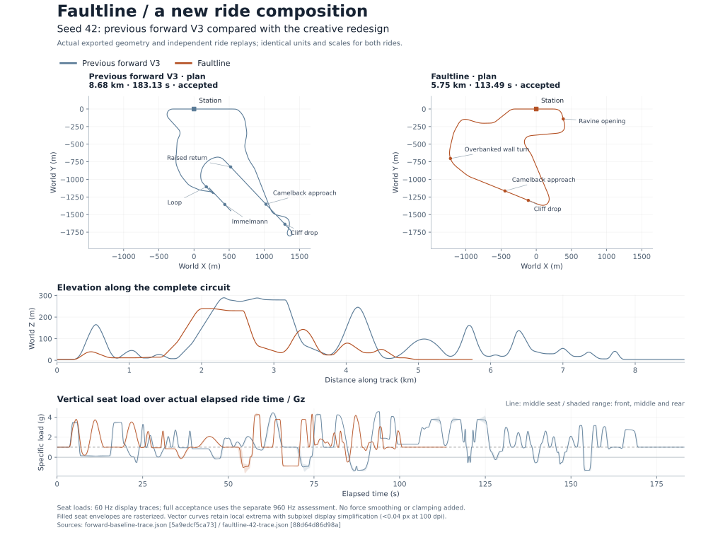

# Faultline: the redesigned default

6 November 2026, Linux Release / GCC 14.2. Version 3.1 replaces the previous
ride composition as well as retaining the forward construction architecture.
The measurements below come from the final local working tree. Full values,
source hashes and all three seating positions are in [results.json](results.json).

## What changed

The low opening folds through a ravine and settles before climbing to one
cliff reveal. A floor boost feeds an original FVD camelback, followed by an
overbanked wall turn and a float/trench/countersteer finale aimed toward the
station. The old full-loop/Immelmann catalog and automatic finale repositioning
connector are gone from the default. Optional recipe acts remain available.

The opening keeps its bank through a light crest. Its earlier negative-load
crest fought the simultaneous turn and caused a rapid counter-roll; changing
the force/geometry intent removed that reversal. Free spline frames now favor
held attitudes between deliberate transitions. They retain the C3 orientation
basis and complete source boundary derivatives. Independent replay measures
the resulting seat loads.

Seeded opening and camelback heights resolve into the editable recipe before
construction. Explicit recipes retain their parameters. The default still has
one coherent composition; these seeds vary element shapes and landscape hand,
not the entire topology. [Design choices and research](../../references/creative-redesign.md)
explain the intent and distinguish it from measured behavior.



## Native results

Generation time excludes serialization and trace export. Each row is one
observed run on this workspace, not a statistical benchmark or cross-platform
speed guarantee.

| Seed-42 revision | Generation | Track | Full replay |
| --- | ---: | ---: | ---: |
| Original main, `5dab7c0` | 28.736 s | 8.595 km | 181.82 s |
| Previous forward rewrite, 3.0 | 7.531 s | 8.682 km | 183.13 s |
| Faultline, 3.1 | **3.153 s** | **5.746 km** | **113.49 s** |

Faultline takes about 89% less generation time than original main in these
runs. The finished seed-42 route has 609 canonical knots, down from 1,345 in
the previous forward ride. All three runs used one construction pass, with no
automatic retry; maximum source-entry speed discrepancy was 0.0021 m/s.

| Seed | Generation | Track | Accepted | Fresh save/load and feel |
| --- | ---: | ---: | --- | --- |
| 42 | 3.153 s | 5,745.67 m | Yes | Pass |
| 7 | 3.013 s | 5,738.99 m | Yes | Pass |
| 99 | 3.168 s | 5,744.61 m | Yes | Pass |

## Experience and tradeoffs

| Seed-42 measurement | Previous forward ride | Faultline |
| --- | ---: | ---: |
| Rest to 180 km/h | 1.397 s | 1.397 s |
| Active time on the cliff top | 19.76 s | 10.89 s |
| Front-seat sustained airtime | 33.31 s | 12.51 s |
| Front-seat contrasting force beats | 23 | 11 |
| Front-seat total body rotation | 29.62 rad | 18.97 rad |
| Front-seat rolling time | 76.05 s | 52.96 s |
| Front-seat rolling fraction | 49.16% | 61.02% |
| Longest front-seat continuous roll | 7.03 s | 4.93 s |
| Longest front-seat quiet interval | 1.54 s | 3.16 s |
| Peak vertical load rate | 16.64 g/s | 8.23 g/s |
| Peak lateral load | 1.621 g | 1.690 g |

This is a shorter ride with fewer repeated gestures, not an attempt to maximize
airtime or beat count. Absolute rotation and rolling time fall, while rolling
fraction rises because the course is shorter. Peak lateral load also rises
slightly; the report retains that excursion above the 1.5 g preference. The
negative peak is −1.579 g against a −1.5 g preference. Actual signed duration,
combined-axis, history and impact assessments pass without a percentage waiver.

Across all seats, existing feel budgets pass: more than 11.8 seconds of airtime,
11 contrasting beats, quiet intervals below 3.2 seconds, continuous rolling
below 5 seconds and rolling fraction below 65%. The longest level coast is
12.1 seconds against the unchanged 15-second budget. Minimum occupied-body
terrain clearance is 2.564 m. These are simulation results, not engineering
certification or proof that every rider will enjoy the composition.

## Review and verification

Twenty existing component suites pass. The three generated saves pass fresh
native validation and the existing front/middle/rear feel checks. No experience
threshold was relaxed for this redesign. Recipe checks now use an explicit
historical fixture for legacy behavior and allow the new optional grammar.

Generate and open the actual offline review:

```sh
cmake -S native -B native/build -DCMAKE_BUILD_TYPE=Release
cmake --build native/build --parallel 8
native/build/coaster_cli generate --seed 42 --terrain highlands --out ride.coaster --json ride.json --trace ride-trace.json --plan ride-plan.json --recipe-out ride.vcrecipe
native/build/ride_feel_tests --design ride.coaster
python3 native/tools/ride_review.py ride --out ride-review.html
```

The self-contained HTML includes actual rail samples, seat positions and forces,
support member axes, station boxes and a sampled terrain overview. It provides
orbit/plan/follow cameras, playback, timeline scrubbing and three seating
positions. Native clearance uses the full canonical geometry. Chromium checks
covered controls, playback, all seats, geometry layers and mobile layout; the
final seeded geometry received an opening/wall playback smoke check. CI exports
the same review alongside each accepted baseline.

Unreal is not installed in this workspace. Its menu mapping was updated, but
editor and packaged runtime behavior remain unverified here. Historical 3.0
and earlier saves remain loadable; their old receipts are not evidence for this
new geometry.
