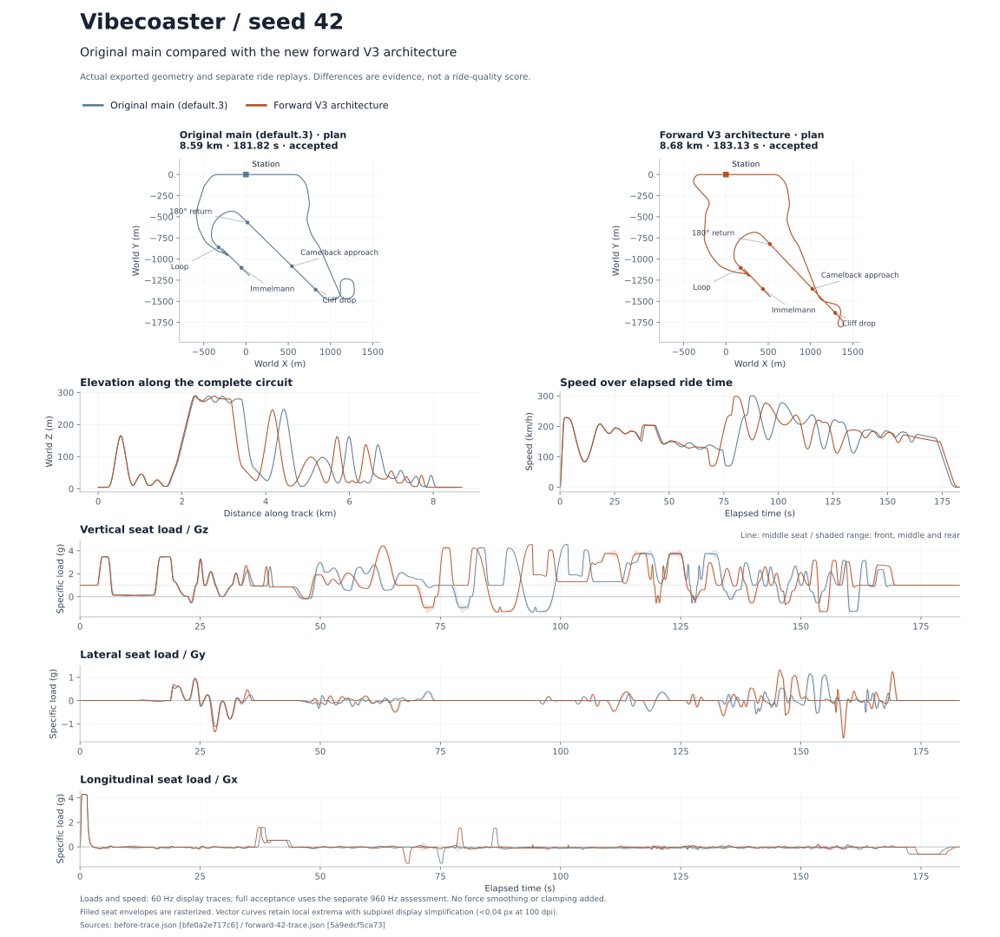

# Forward generator rewrite verification

Historical 3.0 checkpoint. The current ride and verification are documented in
[Faultline 3.1](../faultline/README.md).

6 November 2026, Linux GCC 14.2 Release. Seed 42, highlands, completes generation
and independent acceptance in **7.53 seconds**. Original main (`5dab7c0`) took
28.74 seconds in this workspace; the first V3 implementation took 77–85 seconds.
These are observed runs, not a statistical or cross-platform benchmark.

## Replaced construction architecture

The compiler constructs one forward draft. A persistent finite-train energy
state advances across newly authored geometry; a short copied forecast supplies
the next source's entry speed. The finished draft receives one motion replay for
bank authoring and then independent acceptance. There is no whole-route energy
calibration, prefix-replay mode, candidate retry or acceptance-driven repair.

FVD and spline sources share full boundary derivatives. Source-error-controlled
polynomial spans replace dense fixed sampling: this ride uses **1,345 canonical
knots**, compared with **26,600** in the first V3 implementation. Centerline C4
and physical orientation C3 support continuous offset-rider jerk when composed
with the smooth drive model. Banking derivatives are analytic; they no longer
depend on a dense finite-difference stencil. Local FVD solves integrate endpoint
state, constructing and assessing each final source only once.

Station closure uses curvature ramps, constant-radius arcs and a short straight.
Its placement follows the approaching signature geometry. The final approach
is 548 m / 12.13 s, with a 3.31-second straight between loaded turns. Terrain has
one owner for the mesa; the ascent is a viaduct reaching its rear slope, without
an overlapping artificial earth ribbon burying the later downhill launch.

## Actual ride comparison

| Measure | Original main | Forward V3 |
| --- | ---: | ---: |
| Generation | 28.74 s | 7.53 s |
| Ride duration | 181.82 s | 183.13 s |
| Rest to 180 km/h | 1.397 s | 1.397 s |
| Clifftop active time | 26.25 s | 19.76 s |
| Front-seat airtime below 0.25 g | 33.41 s | 33.31 s |
| Front-seat contrasting force beats | 23 | 23 |
| Longest neutral unpowered front-seat gap | 1.79 s | 1.54 s |
| Front-seat absolute body roll | 27.53 rad | 29.62 rad |
| Maximum lateral seat load | 1.172 g | 1.621 g |
| Longest level coast, including loaded turns | 5.77 s | 13.07 s |

The shorter shelf and neutral gaps preserve load contrast and airtime. The return
has stronger heading changes and more roll, with a longer level segment. Its two
turns reach roughly 3.06 g and 2.6–2.8 g in the middle seat, so the level-coast
metric is not equivalent to dead time. The experience regression allows 15 seconds
there while separately checking neutral gaps and roll episodes. No exact total
ride duration or historical track snapshot is required.

Nominal force/rate values are preferences, without a universal percentage cap.
The 1.621 g lateral peak exceeds the 1.5 g preference and is reported. All three
seat positions pass the separately scoped signed-duration, paired-axis, reversal
and negative-history assessments. This is selected F2291-25 numerical assessment,
not human-safety or whole-standard certification. The measured source-entry speed
error is at most 0.00263 m/s; the final independent energy residual is about
1.1e-9 J/kg. Occupied-envelope ground clearance is 2.56 m.



## Verification and compatibility

The Release build and all 20 existing component suites pass. Freshly loading the
accepted saves and their focused ride-feel checks pass for all three seeds.
Convergence/cancellation, atomic save interruption, the representative roundtrip,
and canonical persistence/migration checks also pass.

| Seed | Generation | Canonical knots | Generate / fresh load / feel |
| --- | ---: | ---: | --- |
| 42 | 7.53 s | 1,345 | Pass |
| 7 | 7.75 s | 1,323 | Pass |
| 99 | 7.63 s | 1,342 | Pass |

Machine-readable receipts are in [results.json](results.json).

The regression scope was reduced: removed obsolete bootstrap/calibration tests,
automatic trim-placement tests and the historical eight-case generator matrix.
The representative integration path checks complete motion, energy, all-seat
assessment, meaningful load contrast and fresh save/load. One small high-speed
boundary regression prevents a zero-progress planning loop.

COASTER6 saves retain their positional compatibility fields and original identity.
JSON reports now use schema 2 and `experienceTargets`; candidate and unused
closure-iteration report fields are removed. Retired `--candidates`,
`--closure-iterations` and `--trims` options reject explicitly. Rate preferences
use `--lateral-rate-target` / `--longitudinal-rate-target`, with the old rate-limit
spellings retained as aliases.

Unreal and PowerShell are unavailable here. Core wrappers and viewer integration
were source-reviewed; no Unreal build, rider-view approval or packaged-runtime
claim is made. Primary manufacturer images and published authoring research were
reviewed; fresh official POV playback was unavailable. See the
[research record](../../references/generator-rewrite-research.md).

## Reproduce

```sh
cmake -S native -B native/build -DCMAKE_BUILD_TYPE=Release
cmake --build native/build --parallel 8
ctest --test-dir native/build --output-on-failure -L component
native/build/coaster_cli generate --seed 42 --terrain highlands --out ride.coaster --json ride.json --trace ride-trace.json --plan ride-plan.json
native/build/ride_feel_tests --design ride.coaster
native/build/organic_generation_tests --design ride.coaster
```

Bulk traces, saves and test logs remain in ignored `out/rewrite`. The comparison
figure uses 60 Hz presentation traces; independent acceptance assesses the
960 Hz replay and its 1920 Hz refinement.
